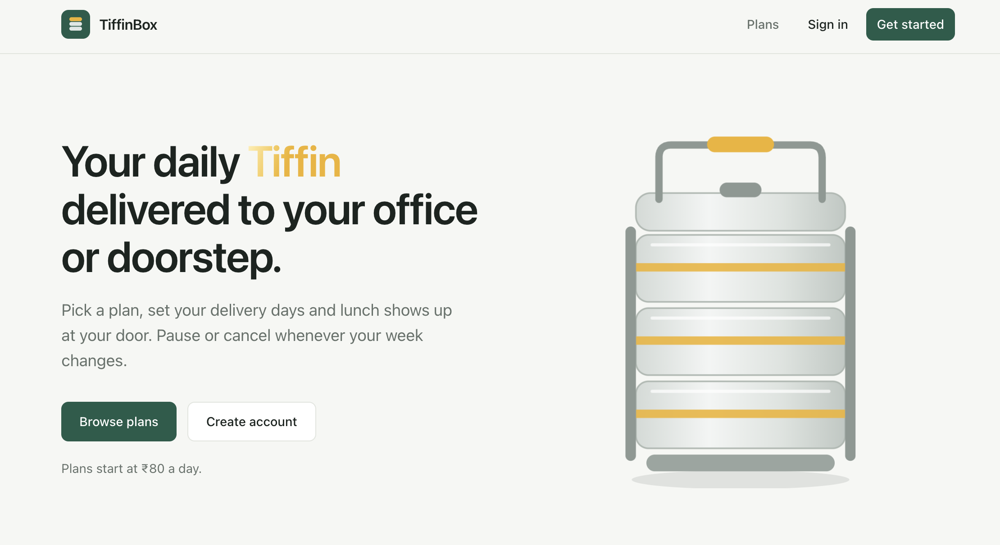
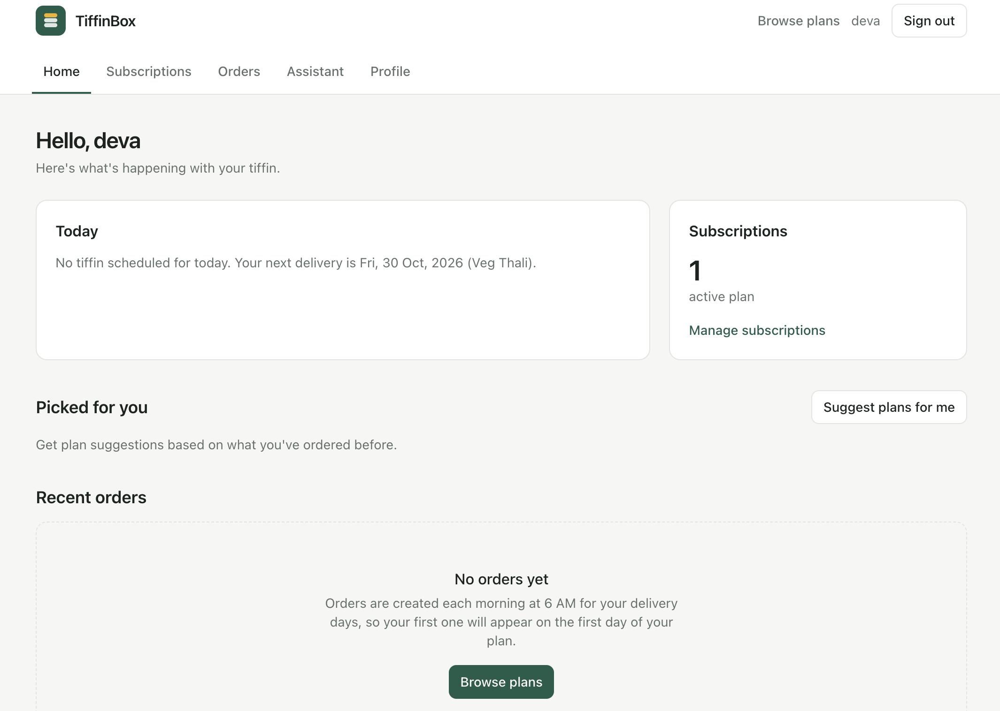

# TiffinBox

A full-stack tiffin / meal subscription app. Users browse meals, subscribe to plans, and get orders generated automatically. The backend also includes AI-powered routes built on Google Gemini.

**Live demo:** https://tiffin-box-delivery.vercel.app/
**API:** https://tiffinbox-delivery.onrender.com/health

> The API runs on Render's free tier, so the first request after a quiet period can take 30 to 60 seconds while the server wakes up.

<!-- TODO: add 2-3 screenshots or a short GIF here, e.g.  -->




## Features

- Authentication with short-lived access tokens and refresh tokens, stored in httpOnly cookies
- Meal catalogue
- Meal subscriptions
- Order management, with orders generated automatically by a scheduled job
- AI-assisted routes using Google Gemini
- Input validation, rate limiting, and structured logging

<!-- TODO: replace or extend this list with the exact features your app has -->

## Tech Stack

| Layer | Technologies |
| --- | --- |
| Frontend | React, Vite, TypeScript |
| Backend | Node.js, Express, TypeScript |
| Database | PostgreSQL (Neon), Prisma ORM |
| Auth | JWT (access + refresh), bcryptjs, cookie-parser |
| Validation and security | Zod, Helmet, CORS, express-rate-limit |
| Jobs and logging | node-cron, Winston |
| AI | Google Gemini (`@google/genai`) |
| Hosting | Vercel (frontend), Render (API), Neon (database) |

## Project Structure

```
TiffinBox-Delivery/
├── backend/
│   ├── prisma/          # schema.prisma, seed.ts
│   └── src/
│       ├── config/      # environment config
│       ├── jobs/        # scheduled order generator
│       ├── middleware/  # error handler and others
│       ├── modules/     # auth, meals, subscriptions, orders, ai
│       └── utils/       # logger, cookies, helpers
└── frontend/
    └── src/             # React app
```

## API Overview

All routes are prefixed with `/api/v1`.

| Route | Purpose |
| --- | --- |
| `/auth` | Register, login, refresh, profile, logout |
| `/meals` | Meal catalogue |
| `/subscriptions` | Subscription management |
| `/orders` | Orders |
| `/ai` | Gemini-powered features |
| `/health` | Health check (served at the root, outside `/api/v1`) |

<!-- TODO: add the exact endpoints and request/response examples, or link to a Postman collection -->

## Running Locally

**Prerequisites:** Node.js 18+, a PostgreSQL database (a free Neon project works), and a Gemini API key.

### 1. Clone

```bash
git clone https://github.com/deva-ydv/TiffinBox-Delivery.git
cd TiffinBox-Delivery
```

### 2. Backend

```bash
cd backend
npm install
cp .env.example .env
```

Fill in `backend/.env`:

| Variable | Description |
| --- | --- |
| `NODE_ENV` | `development` |
| `PORT` | `3000` |
| `DATABASE_URL` | PostgreSQL connection string |
| `JWT_ACCESS_SECRET` | Random secret, at least 32 characters |
| `JWT_REFRESH_SECRET` | A different random secret |
| `JWT_ACCESS_EXPIRES_IN` | `15m` |
| `JWT_REFRESH_EXPIRES_IN` | `7d` |
| `CLIENT_URL` | `http://localhost:5173` |
| Gemini API key | See the variable name in `.env.example` |

Generate a secret with:

```bash
node -e "console.log(require('crypto').randomBytes(64).toString('hex'))"
```

Then create the tables, optionally seed them, and start the server:

```bash
npm run db:push
npm run db:seed    # optional
npm run dev
```

The API runs at `http://localhost:3000`.

### 3. Frontend

```bash
cd frontend
npm install
npm run dev
```

The app runs at `http://localhost:5173`. By default it calls `http://localhost:3000/api/v1`. To point it elsewhere, create `frontend/.env`:

```
VITE_API_URL=http://localhost:3000/api/v1
```

## Deployment

| Part | Platform | Notes |
| --- | --- | --- |
| Frontend | Vercel | Root directory `frontend`, `VITE_API_URL` set to the API URL, SPA rewrite in `vercel.json` |
| Backend | Render | Root directory `backend`, build `npm install --include=dev && npx prisma generate && npm run build`, start `npm start` |
| Database | Neon | Schema applied with `prisma db push` |

Because the frontend and API are on different domains, production cookies use `SameSite=None; Secure`, CORS allows the frontend origin with credentials, and Express runs with `trust proxy` enabled.

## What I Learned

<!-- TODO: 3-4 bullets in your own words, e.g. cross-site cookie auth, moving from MongoDB/Mongoose to Prisma + PostgreSQL, deploying a monorepo, scheduled jobs -->

## Author

Built by [@deva-ydv](https://github.com/deva-ydv).
